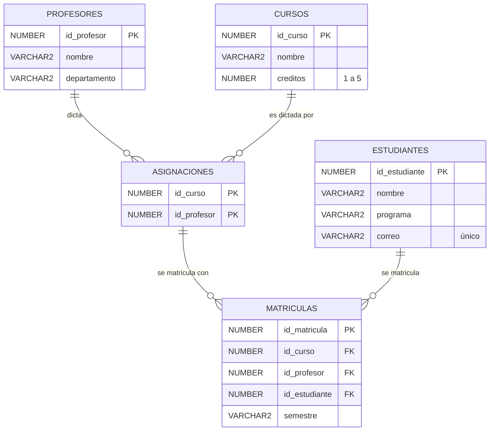

# Registro Académico sobre Oracle Database

Proyecto final de **Administración de Bases de Datos**. Es un sistema de registro académico de estudiantes, materias, profesores y matrículas, construido sobre **Oracle Database 26ai Free** en Docker, con una aplicación web para operarlo.

Parte del taller del **Caso 4** (cursos, profesores y matrículas). El script original del taller se usa sin cambios, y sobre él se agregó:

- **Gestión de almacenamiento:** tablespaces separados para datos, índices, auditoría y temporales.
- **Usuarios y seguridad:** política de contraseñas, perfil, 4 roles y un paquete PL/SQL para administrar cuentas.
- **Auditoría:** bitácora con valores antes y después de cada cambio, más la auditoría unificada de Oracle.
- **Backup y recuperación:** RMAN, Data Pump y Flashback, con demostraciones en vivo.
- **Aplicación web:** formularios para registrar, matricular, consultar y administrar usuarios.

> **Para ver todo el código con una guía:** descarga [`docs/codigo-del-proyecto.html`](docs/codigo-del-proyecto.html) (botón *Download raw file*) y ábrelo en el navegador. Tiene la explicación del proyecto y todos los archivos, navegables y con buscador.

## Tecnologías

| Parte | Tecnología |
|---|---|
| Base de datos | Oracle AI Database 26ai Free en Docker (imagen `gvenzl/oracle-free`), base conectable `FREEPDB1` |
| Scripts | SQL y PL/SQL con SQL*Plus; RMAN y Data Pump para backups |
| Aplicación web | Next.js 16, React 19, shadcn/ui y Tailwind CSS 4 |
| Conexión a Oracle | `oracledb` en modo thin: no hace falta instalar Oracle Client |

## Instalación paso a paso

### 1. Requisitos

- **[Docker Desktop](https://www.docker.com/products/docker-desktop/)**, abierto y en estado *running*.
- **[Node.js](https://nodejs.org/) 20 o superior** (versión LTS).
- **Git**.
- **En Windows:** WSL con Ubuntu, porque los scripts son de bash. En PowerShell como administrador ejecuta `wsl --install`, reinicia y sigue los pasos dentro de la terminal de Ubuntu.

### 2. Descargar el proyecto

```bash
git clone https://github.com/juandavidardila207/proyecto-final-materia-admin-bases-de-datos.git
```

```bash
cd proyecto-final-materia-admin-bases-de-datos
```

```bash
chmod +x *.sh backup/*.sh
```

### 3. Crear la base de datos

Descarga Oracle Database Free (unos 3 GB) y lo inicia en un contenedor llamado `oracle`, con un volumen para que los datos no se pierdan. La primera vez tarda varios minutos.

```bash
./crear_contenedor.sh
```

### 4. Instalar el proyecto en la base

Crea tablespaces, usuarios, roles, tablas, datos, bitácora y auditoría.

```bash
./instalar.sh
```

### 5. Activar los backups (opcional)

Solo hace falta para usar RMAN y las demostraciones de recuperación. Reinicia la base una vez.

```bash
backup/01_activar_archivelog.sh
```

### 6. Encender la aplicación web

La primera vez instala dependencias y compila (alrededor de un minuto). Cuando aparezca `Abre http://localhost:3000`, entra a <http://localhost:3000>.

```bash
./iniciar.sh
```

Para apagarla, `Ctrl + C`. Las veces siguientes basta con abrir Docker Desktop y ejecutar de nuevo `./iniciar.sh`.

## Uso

### Iniciar sesión

Cada persona entra con un usuario **real de Oracle**: los permisos y la auditoría los aplica la base de datos. Las contraseñas están en [`sql/00_parametros.sql`](sql/00_parametros.sql).

| Usuario | Rol | Puede |
|---|---|---|
| `U_CONSULTA` | Consulta | Ver estudiantes, materias, profesores, tablas y reportes; usar la consola SQL |
| `U_OPERADOR` | Operador | Lo anterior, y además registrar, editar, eliminar y matricular |
| `U_AUDITOR` | Auditor | Ver los datos y la auditoría |
| `U_ADMIN` | Administrador | Todo, incluidos usuarios y almacenamiento |

Tras 5 contraseñas erradas la cuenta se bloquea una hora; un administrador puede desbloquearla en **Usuarios**.

### Qué se puede hacer en la web

| Sección | Para qué |
|---|---|
| **Matricular materias** | Buscar al estudiante, elegir el semestre y matricular varias materias con su profesor en un solo paso |
| **Estudiantes, Materias, Profesores** | Registrar, editar y eliminar; elegir qué profesores dictan cada materia (también desde **Editar**) |
| **Reportes del taller** | Las 4 consultas obligatorias con su SQL y resultado, descargables en CSV |
| **Tablas** | Consultar y modificar cualquier tabla con búsqueda y orden |
| **Consola SQL** | Ejecutar sentencias con los permisos del usuario conectado |
| **Usuarios** | Crear cuentas, cambiar rol, restablecer contraseña, bloquear y eliminar |
| **Almacenamiento** | Tablespaces, objetos del proyecto e historial de backups |
| **Auditoría** | Bitácora de cambios y auditoría unificada de Oracle |

### Conectarse con SQL Developer

Crea una conexión con: host `localhost`, puerto `1521`, nombre del servicio `FREEPDB1`, usuario `UNIVERSIDAD` y la contraseña `pw_owner` de `sql/00_parametros.sql`. También puedes entrar con los usuarios `U_*` y comprobar que Oracle les aplica los mismos permisos.

## Modelo de datos

Las tres tablas del taller (`PROFESORES`, `CURSOS`, `MATRICULAS`) no cambiaron. Se agregaron `ESTUDIANTES`, porque el esquema original solo guardaba un código numérico del estudiante, y `ASIGNACIONES`, que define qué materias dicta cada profesor.



| Restricción | Qué impide | Origen |
|---|---|---|
| `CHECK (creditos BETWEEN 1 AND 5)` | Materias con créditos fuera de rango | Taller |
| `FK_MAT_CURSO`, `FK_MAT_PROFESOR` | Matrículas con materia o profesor inexistente | Taller |
| `FK_MAT_ESTUDIANTE` | Matricular a alguien que no está registrado | Agregada |
| `FK_MAT_ASIGNACION` | Matricular con un profesor que no dicta esa materia | Agregada |
| `UQ_MAT_EST_CURSO_SEM` | La misma materia dos veces para un estudiante en un semestre | Agregada |
| `UQ_EST_CORREO`, `CK_EST_CORREO` | Correos repetidos o sin formato válido | Agregada |

## Requisitos del proyecto y dónde están

| Requisito | Archivos |
|---|---|
| Base del taller | [`sql/03_taller_freesql.sql`](sql/03_taller_freesql.sql) |
| Gestión de almacenamiento | [`sql/01_almacenamiento.sql`](sql/01_almacenamiento.sql), [`sql/04_organizacion_fisica.sql`](sql/04_organizacion_fisica.sql) |
| Usuarios y roles | [`sql/02_usuarios_roles.sql`](sql/02_usuarios_roles.sql), [`sql/05_seguridad.sql`](sql/05_seguridad.sql) |
| Backup y recuperación | [`backup/`](backup/) |
| Auditoría | [`sql/05_seguridad.sql`](sql/05_seguridad.sql), [`sql/06_auditoria.sql`](sql/06_auditoria.sql) |
| Consultas del taller | [`sql/07_consultas.sql`](sql/07_consultas.sql) |
| Interfaz para consultar, modificar y gestionar usuarios | [`web/`](web/) |

### Estructura del repositorio

```
.
├── crear_contenedor.sh   Crea el contenedor de Oracle
├── instalar.sh           Instala el proyecto en la base
├── iniciar.sh            Enciende Oracle y la aplicación web
├── desinstalar.sh        Borra solo los objetos del proyecto
├── sql/                  Scripts de la base, en el orden en que se ejecutan
├── backup/               Scripts de backup, recuperación y demostraciones
│   └── archivos/         Export de Data Pump con los datos actuales
├── web/                  Aplicación web (Next.js)
└── docs/                 Página con la guía y todo el código
```

## Decisiones de diseño

- **Se entra con usuarios reales de Oracle.** La web no tiene permisos propios: cada persona se conecta con su cuenta, Oracle aplica los privilegios y la auditoría registra a la persona real.
- **El administrador no tiene `CREATE USER` ni `ALTER USER`.** Solo puede ejecutar el paquete `UNIV_SEC.PKG_USUARIOS`, que únicamente toca cuentas `U_*` y los 4 roles. Por eso no puede bloquear a `SYSTEM` ni entrar a otros esquemas.
- **`UNIV_SEC` no tiene contraseña** (`NO AUTHENTICATION`): nadie puede iniciar sesión con la cuenta dueña de la bitácora.
- **La bitácora no se puede editar ni borrar:** un trigger lo impide.
- **Índices separados de los datos:** se pueden administrar y recuperar por aparte.
- **Matrícula en una sola transacción:** si una de las materias falla, no se guarda ninguna.
- **Asignaciones en cascada:** al borrar una materia o un profesor sin matrículas, sus asignaciones se borran solas.

## Backup y recuperación

Scripts de la carpeta [`backup/`](backup/):

| Script | Qué hace |
|---|---|
| `01_activar_archivelog.sh` | Crea la Fast Recovery Area y activa ARCHIVELOG. Reinicia la base; se ejecuta una vez |
| `02_backup_rman.sh [--copiar]` | Backup físico completo con RMAN. Con `--copiar`, también lo guarda en `backup/archivos/` (~1 GB) |
| `03_export_datapump.sh` | Backup lógico del esquema con Data Pump, en `backup/archivos/` |
| `04_import_datapump.sh <archivo.dmp>` | Restaura el esquema reemplazando las tablas (pide confirmación) |
| `demo_1_flashback.sh` | Borra matrículas y las recupera con `FLASHBACK TABLE` |
| `demo_2_perdida_datafile.sh` | Borra el datafile de datos y lo recupera con RMAN (pide confirmación) |

Los backups de RMAN se guardan dentro del contenedor. `docker stop` y `docker restart` son seguros, pero `docker rm oracle` los borraría junto con la base: usa `--copiar` si quieres conservarlos fuera.

Dos hallazgos de las pruebas:

1. Con el datafile de datos perdido, `SELECT COUNT(*)` **sigue funcionando**, porque Oracle lo responde con el índice, que está en otro tablespace. Por eso la demostración usa `COUNT(semestre)`, que sí obliga a leer la tabla y da `ORA-00376`.
2. `impdp` con `TABLE_EXISTS_ACTION=REPLACE` recrea las tablas y deja la política de auditoría de datos **activa pero vacía**. El script de import la vuelve a crear y comprueba que tenga sus 14 acciones.

## Guion para la demostración

1. **Reportes:** las 4 consultas del taller con enunciado, SQL y resultado.
2. **Registro completo**, como `U_OPERADOR`: registrar un estudiante, una materia y un profesor; asignarle la materia al profesor (en **Editar** de la materia o del profesor); y matricular al estudiante desde su fila. Luego mostrar los cambios en SQL Developer.
3. **Permisos:** como `U_CONSULTA`, ejecutar `DELETE FROM matriculas` en la consola SQL. Oracle lo rechaza.
4. **Integridad:** en **Tablas**, crear una materia con 9 créditos (`ORA-02290`), eliminar la materia 101, que tiene matrículas (`ORA-02292`), y registrar un estudiante con un correo repetido.
5. **Auditoría:** como `U_AUDITOR`, ver los cambios del paso 2 con su usuario y sus valores antes y después.
6. **Usuarios:** como `U_ADMIN`, crear un usuario, cambiarle el rol y bloquearlo; intentar entrar con él.
7. **Almacenamiento:** tablespaces y dónde está cada tabla e índice.
8. **Recuperación:** ejecutar `backup/demo_2_perdida_datafile.sh` en vivo.

## Pruebas

Con la aplicación encendida, desde `web/`:

```bash
npm test
```

Son 102 comprobaciones contra la base real: permisos por rol, restricciones, formularios, matrícula, asignaciones, usuarios y auditoría. Dejan los datos como estaban, pero sus cambios quedan registrados en la bitácora y la auditoría.

## Solución de problemas

| Síntoma | Solución |
|---|---|
| `Cannot connect to the Docker daemon` | Abre Docker Desktop y espera a que diga *running* |
| La web dice «No hay conexión con la base de datos» | `docker start oracle` y espera un minuto |
| Ya tienes otro Oracle en el puerto 1521 | `PUERTO=1522 ./crear_contenedor.sh` y luego `DB_CONNECT=localhost:1522/FREEPDB1 ./iniciar.sh` |
| `address already in use` en el puerto 3000 | `PORT=3100 ./iniciar.sh` y abre <http://localhost:3100> |
| «Usuario o contraseña incorrectos» | Revisa `sql/00_parametros.sql`; los usuarios van en mayúsculas |
| «La cuenta está bloqueada» | Entra como `U_ADMIN` → **Usuarios** → desbloquear |
| `instalar.sh` falla porque ya está instalado | Ejecuta antes `./desinstalar.sh`, que borra solo los objetos del proyecto |
| Cambiaste código de `web/` y no se ve | `cd web && npm run build`, luego `./iniciar.sh` |

## Notas

- La instalación carga los datos del sistema tal como estaban ([`sql/03d_datos_actuales.sql`](sql/03d_datos_actuales.sql)): 31 profesores, 41 materias, 61 estudiantes, 121 asignaciones y 121 matrículas. El historial de la bitácora y de la auditoría no se incluye: una instalación nueva arranca vacía.
- Las contraseñas de `sql/00_parametros.sql` son de demostración, para una base local. Si instalas el proyecto en un servidor, cámbialas antes de instalar.
- El taller pide "código del departamento", pero el esquema entregado solo tiene `departamento` como texto; la consulta 4 usa ese nombre.
- Si instalaste una versión anterior a la tabla `ASIGNACIONES`, [`migrar_asignaciones.sh`](migrar_asignaciones.sh) la agrega sin borrar datos.
